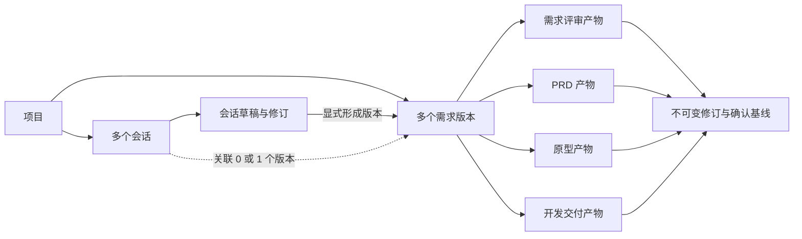

# 项目、会话与需求版本生命周期设计

状态：总体生命周期方案；阶段 A–B 已实现，阶段 C–D 待建设。日期：2026-10-13。作者：Andersen。

本文保留初次设计方案。随后用户授权实施第一阶段，并允许不保留旧需求评审功能及历史数据。因此阶段 A 改为新的项目/会话/需求版本目录与范围编辑，不迁移旧评审对象、不兼容旧项目链接、不复用旧评审和 PRD 界面。阶段 A 实际落地以 [第一阶段实现设计](workspace-phase-one-design.md) 和 [验证记录](workspace-phase-one-validation.md) 为准；阶段 B 以 [需求与 PRD 生命周期设计](requirement-prd-lifecycle-design.md) 为准；下文旧数据迁移与旧界面复用条款为原提案，不再适用于本轮。适用范围为单人桌面工作空间，继续使用 Vue 3、shadcn-vue、PostgreSQL 与 MyBatis Plus。

## 1. 现状与问题

当前 `ProjectService.create` 接收一次业务输入，执行 Graph，创建一份 `ProjectDocument`。这份对象同时保存项目名称、原始输入、需求、问答、建议和 PRD。`project_versions` 每次保存增加一个 revision；工作台将其显示为 v1、v2 等版本。

因此，当前项目实际承担的是需求文档职责；当前“版本”是保存快照，没有表示某次交付的业务范围。系统也尚未持久化多轮会话、独立 PRD 定稿、原型和开发验收状态。仅调整左侧菜单不能解决这些概念混用。

目标结构：项目组织长期背景和多个会话；会话推动讨论与产物编辑；明确形成需求版本后，以这个版本为单位完成需求评审、PRD、原型、开发与验收。

## 2. 正式需求、建议和范围

### 用户已明确的需求

- 工作空间采用项目与会话的组织方式。
- 讨论结果可形成需求版本，支持自行定义版本名称。
- 同一需求版本经历需求评审、PRD、原型、开发落地，完成落地后生命周期才结束。
- 当前先设计，暂不进入实现。
- 不考虑移动端，不增加多人、成员、租户或权限模块。

### 本方案建议的默认规则

- 一个项目代表一个持续维护的产品或业务系统，不要求绑定代码仓库才能开始。
- 同一项目可以存在多个并行推进的需求版本；版本用于组织一次可验收的交付范围，可包含多条需求。
- 会话可以先探索，再形成版本；也可以先手工创建版本，再开启关联会话。
- 一个会话最多关联一个需求版本；一个版本可以有多个需求、PRD、原型和开发会话。
- 四个阶段固定，不在第一阶段引入任意工作流配置器。
- 开发落地先支持实施任务、交付证据和人工验收；代码仓库执行能力作为后续独立建设内容。

## 3. 概念与关系

| 概念 | 负责什么 | 例子 |
| --- | --- | --- |
| 项目 Project | 产品背景、项目约束、会话与需求版本的归属 | 客户运营系统 |
| 会话 Session | 一次持续讨论及模型执行记录，可重命名、归档、恢复 | 讨论客户导入流程 |
| 会话草稿 Draft | 从讨论中提取、可编辑的结构化需求候选内容 | 客户导入的待确认需求与问题 |
| 需求版本 RequirementVersion | 一次有明确范围和目标的交付单元，拥有独立生命周期 | v1.0 · 客户导入 |
| 保存记录 Revision | 草稿或产物内部的编辑快照，不创建新交付单元 | 第 3 次保存，r3 |
| 产物 Artifact | 需求评审稿、PRD、原型或开发交付记录 | PRD r4、原型 r2 |
| 已确认基线 Baseline | 用户明确确认的不可变产物快照，供下一阶段引用 | 本轮原型基于已确认 PRD r4 |



### 两种“版本”的命名

需求版本显示用户定义的名称，如 `v1.0`、`一期客户管理`、`2026-10 客户导入`，不强制语义化版本号。名称在同一项目内去除首尾空白后唯一；稳定 UUID 承担关联关系，改名不会改变 URL 或引用。版本之间按创建顺序和更新时间排序，不按名称推断大小。

编辑快照显示“保存记录 #3”或“PRD r3”。保存评审不自动创建 v1.1，也不推进阶段。界面同时展示业务版本名称与当前产物修订，避免继续混淆。

## 4. 用户完整路径

### 从讨论形成版本

1. 创建“客户运营系统”项目，填写背景和约束；创建项目不自动调用模型。
2. 在项目下新建“客户导入流程”会话，发送业务需求。模型追问、分析或提出方案，完整消息保存于会话。
3. 用户点击“整理需求草稿”，结构化需求、澄清问题、设计建议进入右侧草稿区。会话仍可继续。
4. 编辑草稿后点击“形成需求版本”，填写版本名称、目标、范围摘要；确认使用哪一次已保存草稿。
5. 原子创建需求版本及首份需求评审产物，并将来源会话关联该版本。相同请求重试不会重复创建版本。
6. 在版本内继续需求评审，确认后推进至 PRD、原型、开发；按需新建阶段会话，保持版本归属。
7. 提交开发交付证据，逐项验收；显式完成验收后，版本显示已完成，可归档。

### 先定义版本

用户也可以从项目概览点击“新建需求版本”，先填写名称和目标。版本从需求评审阶段开始，尚无确认基线。随后在该版本内新建会话或手工编写需求。没有空白会话或初始模型响应也可以创建版本。

### 会话与产物的写入边界

普通对话只追加消息，不直接改写正式需求。用户显式点击“整理草稿”“更新草稿建议”或“生成 PRD”等产物动作时，模型返回候选结果；查看差异并应用后才写入编辑副本。已确认需求改变后撤销确认，已接受建议的来源关系继续保留。

每个会话首期只有一份当前需求草稿及其保存历史。一个探索会话首次形成版本后绑定该版本；后续讨论维护同一版本，不重复形成多个版本。新交付范围使用新会话或新版本。可以把一个尚未绑定版本的探索会话关联已有版本，但需明确确认目标，草稿作为候选内容合并，不整份覆盖正式需求。

会话切换允许进行中的模型任务继续执行；返回原会话可以读取状态和结果。未保存的产物编辑仍需保存或明确放弃。已提交消息与正在输入但未提交的文本分开处理，输入区草稿首期保留于当前页面内存，不写浏览器持久化。

## 5. 生命周期与阶段门槛


| 阶段 | 工作内容与产物 | 前进条件 |
| --- | --- | --- |
| 需求评审 | 背景、范围、正式需求、澄清问题、建议处理、验收目标 | 范围内需求全部确认；阻塞问题已解决；待处理建议已明确接受、拒绝或延期；人工确认评审基线 |
| PRD | 目标、范围、业务流程、规则、异常路径、需求关联与验收标准 | 基于有效需求基线；文档必要内容完整；人工确认 PRD 基线 |
| 原型 | 页面、流程、交互状态、预览与需求映射 | 基于有效 PRD；关键需求有对应页面/流程；人工确认原型基线 |
| 开发与验收 | 实施任务、交付变更、测试记录、验收结果 | 基于有效 PRD 和原型；任务完成、必验项目通过、阻塞问题解决；人工确认完成 |

需要补充当前模型中尚无的验收目标和问题处理字段。问题可标记为阻塞或非阻塞，延期需理由；默认新问题为阻塞。未接受建议不自动成为需求。验收标准的模型建议同样需要人工确认。

“确认基线并进入下一阶段”是独立命令，服务器校验目标修订、状态和前置基线后写入同一事务。单项勾选、保存、下载、生成成功都不代表阶段完成。第一阶段完成率与整体生命周期进度分别展示。

草稿 PRD 仍可在需求评审阶段生成和导出，带有草稿标识；确认评审之后才进入正式 PRD 阶段。这保留当前预览能力，又明确草稿和正式交付的区别。

### 状态分开表达

- 版本生命周期：`ACTIVE`、`COMPLETED`、`CANCELED`。
- 当前阶段：`REVIEW`、`PRD`、`PROTOTYPE`、`DEVELOPMENT`。已完成版本仍保留最终阶段。
- 归档是独立 `archivedAt`，影响默认列表展示，不代替完成状态。
- 已确认基线不可修改；阶段候选产物可产生新修订。页面显示“待确认”“已确认”“需要同步”等产物状态。

正常完成版本只有通过开发验收后才能归档。中途不再继续的版本需注明原因并标记已取消，之后可归档；已取消不计为已完成。项目只有不存在活动版本和执行中任务时才允许归档。会话可以独立归档和恢复，归档会话不终止版本。

执行中会话暂不能归档，需等待任务结束；切换页面不等于取消任务。恢复归档仅恢复列表可见性，已完成或已取消版本仍保持原生命周期状态。首期已取消版本不原地重启，继续交付可以复制为新版本。

## 6. 上游变更与追溯

每个产物修订记录它引用的需求、PRD 和原型基线 ID；不能只记录“属于这个版本”。模型每次执行也记录其实际使用的上下文修订，避免输出对应不明的当前页面。

例如原型 r2 基于 PRD r4，开发任务基于原型 r2。用户在开发中修改客户导入规则：

1. 从已确认需求复制出新的编辑副本，保存后形成待确认变更；原基线和交付记录保留。
2. 版本显示“存在未确认需求变更”，禁止确认下游新基线和最终完成，但不自动删除或改写已有原型、代码记录。
3. 用户显式“重新评审变更”，当前阶段返回需求评审并写明原因；确认新需求基线后再同步 PRD。
4. 更换上游基线时，下游显示“需要同步”。用户检查差异，生成或修改新修订，再确认；即使判定内容无需修改，也需形成引用新基线的确认记录。
5. 新基线链完整后继续开发验收；此前交付记录作为历史证据保存。

首期对范围内需求正文、规则、验收目标和问题结论的变化保守标记下游需要同步。版本名称、显示排序等元数据修改不触发产物失效。细粒度影响分析可后续增强。

已完成版本的需求与产物只读，后续需求创建新版本，并可复制前版基线作为起点；新版本保留来源引用，不改写已完成交付。

## 7. 桌面信息架构与交互

### 左侧项目与会话导航

```text
project-alpha
  新建会话（选择所属项目）
  项目
    客户运营系统
      项目概览
      需求版本（活动 2 / 已完成 1）
      最近会话
        客户导入流程      [v1.0 · 评审]
        导入页面交互      [v1.0 · 原型]
        分配策略探索      [未形成版本]
    内部管理平台
  归档记录
  系统设置
    接入平台
    模型配置
```

项目可以折叠；最近会话分页加载，更多会话进入项目列表页，避免侧栏无限增长。没有项目时先创建项目。进入已有项目点击“新建会话”默认该项目；进入版本时默认该版本。系统设置保留现有独立页面。

### 项目概览

展示项目说明、活动需求版本卡片、最近会话，以及新建会话/新建版本入口。版本卡片显示名称、目标、当前阶段、待处理事项、更新时间。项目背景可编辑，每次模型运行引用明确的背景修订，已有会话不因背景修改而重写历史。

### 会话工作区

```text
┌───────────┬─────────────────────────┬─────────────────────────┐
│ 项目/会话 │ 项目 > 当前会话         │ 关联版本与当前阶段      │
│ 导航      │ 会话标题 / 模型来源     │ 需求评审 / PRD / 原型   │
│           │                         │ 当前产物编辑或预览      │
│           │ 用户消息、回答、追问    │ 差异 / 来源 / 保存记录  │
│           │ 产物建议卡与应用动作    │ 当前基线及同步状态      │
│           │                         │                         │
│           │ 输入区 / 发送           │ 保存 / 确认并推进       │
└───────────┴─────────────────────────┴─────────────────────────┘
```

固定项目侧栏；中间是会话消息；右侧是按需打开的产物区，可折叠或扩大为主内容，桌面窄窗口用“对话 / 产物”切换，避免强行显示三个拥挤栏。这里只处理桌面空间分配，不增加移动端导航。

会话绑定版本后顶部始终显示版本名称；探索会话明确显示“尚未形成需求版本”。整理草稿后右侧显示“形成需求版本”。原来的需求评审、问题、建议作为需求产物的内部区域，PRD 成为独立阶段产物，“版本历史”改为当前产物的“保存记录”。

输入区展示当前调用模式与模型。切换全局模型仅影响下一次请求，每条模型消息保留当次来源；本地模板消息明确标注，不能呈现为真实模型结果。模型任务失败保留用户消息，显示安全错误与显式重试入口。

### 需求版本详情

顶部为版本名称、目标、整体状态；其下展示四阶段进度条。主区显示当前阶段产物，右侧显示阻塞事项、确认基线和关联会话。可以查看过去阶段，也可创建当前阶段的新会话；点击未来阶段只显示前置要求，不发起模型请求或推进状态。

“形成需求版本”“确认并推进”“完成验收”“取消版本”都展示准确的目标、修订和影响。页面主操作依据上下文选择，避免同时出现多个同等强调的提交按钮。

### 建议路由

继续使用 Hash 路由：

- `/projects`：项目目录。
- `/projects/:projectId`：项目概览。
- `/projects/:projectId/sessions/:sessionId`：会话工作区。
- `/projects/:projectId/versions/:versionId`：版本详情，阶段与产物修订用查询参数表达。
- `/archives`：归档记录；系统设置路径保留。

刷新恢复明确的项目、会话或版本身份。旧 `/workspace?project=...` 链接通过迁移映射进入对应版本，不能无提示打开新空白页。

## 8. 持久化与服务边界建议

保留 PostgreSQL、MyBatis Plus、Flyway。项目、会话、版本和产物关系结构化存储；结构化文档正文继续使用 JSONB，不将完整产品空间塞入一个 JSON 快照。

| 建议表 | 关键职责与字段 |
| --- | --- |
| `workspace_projects` | ID、名称、背景 JSON、revision、created/updated/archive 时间 |
| `work_sessions` | ID、project_id、可空 version_id、标题、阶段上下文、revision、archive 时间；阶段仅表示会话用途，不是版本阶段真值 |
| `session_messages` | ID、session_id、稳定顺序、role、正文/产物引用、安全来源、request_id、created_at；消息只追加 |
| `agent_runs` | ID、session_id、目标版本/产物、输入消息、上下文修订、无凭证模型信息、status、安全错误、结果引用、幂等键 |
| `session_drafts` / `session_draft_revisions` | 会话当前结构化草稿与不可变保存记录、来源消息/run、revision；一个会话一份当前草稿 |
| `requirement_versions` | ID、project_id、唯一 label、目标、范围、lifecycle、current_stage、revision、来源草稿修订、前版来源、归档时间 |
| `version_artifacts` | ID、version_id、kind、当前保存修订、当前确认基线 ID、是否存在未确认内容变更；每版本每种产物首期一条记录 |
| `artifact_revisions` | ID、artifact_id、revision、不可变 JSON/纯文本正文、来源、上游基线依赖、created_at |
| `version_events` | 形成、确认、推进、返回评审、取消、完成、归档等追加事件，关联准确产物修订和原因 |

已确认基线以确认事件及其不可变 `artifact_revision_id` 为依据；产物表只保存当前基线指针，不在历史正文内原地修改确认状态。来源草稿修订 ID 是“形成版本”的唯一键，防止重复沉淀；同项目版本名称唯一约束独立校验。保存修订分别在草稿/产物范围内唯一。

跨项目关联必须由服务端校验，版本、会话、来源产物均属于同一项目；结合复合外键或等价约束保护关键关系。项目及版本用稳定 UUID；摘要查询采用分页及 `updated_at + id` 稳定排序。业务数据采用归档，不默认物理删除。

服务建议：ProjectService 管理项目容器；SessionService 管理消息与任务；RequirementVersionService 管理范围、关联和阶段命令；ArtifactService 管理文档与不可变修订。现有需求确认、建议来源和 PRD 渲染规则提取复用，Controller 与 Mapper 分层保持不变。

### 消息执行与业务写入

提交消息先持久化用户消息和执行任务，再在事务外调用模型；每会话首期最多一个进行中任务。请求幂等键及唯一约束防止刷新/重试重复提交。运行状态至少包含 `QUEUED/RUNNING/SUCCEEDED/FAILED/INTERRUPTED`，同一请求重复读取不能隐式重调模型。

首期可用后端任务加状态轮询，真实记录运行状态，不模拟流式文本。服务重启后未完成任务标记中断，保留输入，允许用户明确重试。Graph 检查点恢复、自动重试与 SSE 独立评估，不把保存消息描述为 Graph 已可恢复。

候选结果携带生成时的目标修订；用户应用时校验 expectedRevision。期间发生编辑则展示过期提示和差异，不自动覆盖。模型请求上下文由项目背景修订、版本已确认基线、当前会话消息与明确来源的摘要构成，限制长度；不会把其他项目会话混入上下文，也不把 API Key 写入消息或任务表。

### 命令接口方向

在现有 `/api/alpha` 前缀下，逐步增加：项目创建与编辑；项目下会话/版本分页；会话消息提交和运行状态读取；草稿保存与形成版本；版本产物保存与候选结果应用；确认基线与阶段推进；交付记录保存与验收完成；归档/恢复。

关键写入使用 expectedRevision；形成版本、提交消息、确认推进和完成验收使用幂等键。阶段完成采用显式命令，不能通过任意 PUT lifecycle 绕过门槛。沿用统一响应与 409 冲突契约，增加前置基线失效、阶段门槛未满足、目标不属于项目等业务错误。

## 9. 当前数据迁移策略

实施时新增 Flyway 迁移，不改已执行 V1–V3，也不在设计阶段执行 SQL。

- 每个旧 `ProjectDocument` 默认迁入一个真实项目和一个“历史需求”版本；保持旧项目 ID 到新版本 ID 的映射，不根据相似名称自动合并项目。
- 最新完整文档迁为需求评审产物；旧 `project_versions` 原样转为该产物的保存记录，保留顺序、时间、稳定需求/问题/建议 ID 和导出内容。旧 v1、v2 不转换为两个业务版本。
- 原始输入和初次生成文档形成标记为历史导入的来源记录，不伪造多轮对话，也不把每次人工保存变成模型消息。
- 旧 PRD 作为历史草稿导出保留；旧版本默认停留在需求评审，不因为已有 Markdown 或全部勾选而自动判定正式 PRD、原型或开发完成。
- 模型来源按历史已存信息保留，未知模型名称保持未知，不填当前全局模型冒充历史来源。
- 初次迁移不物理删除旧表；先核对项目数量、修订数量、正文、来源关系与旧链接，再切换新接口读取。退出兼容需独立计划，不能长期让新旧接口各自写入两份真值。

## 10. 分期实施与验收

### 阶段 A：建立项目、会话、需求版本骨架

实现新对象、迁移与旧链接兼容；项目/会话导航；多轮消息持久化与任务状态；会话草稿；自定义版本命名与形成版本；版本内复用现有评审、问答、建议、保存、PRD 草稿导出。

展示完整四阶段路径，但 PRD 定稿、原型生成、开发执行等尚未实现的能力明确标记未接入，不能点击即假完成。优先验收一个项目两个会话不互相覆盖、多次保存仍属于同一个需求版本、归档会话不结束版本、模型失败/刷新不丢消息、旧数据及来源完整。

### 阶段 B：需求与 PRD 基线

实现阻塞问题、验收目标、人工基线确认、正式 PRD 完整结构与修订、阶段门槛、上游变更同步和进度。验证下载草稿不推进阶段、未确认内容不能定稿、修改上游不能静默继续下游。

### 阶段 C：原型产物

先支持结构化页面规格、交互说明、需求映射及版本化原型链接；随后接入独立原型生成和隔离预览。外部 HTML 不进入业务页面直接 v-html 渲染，执行型预览采用独立隔离边界。确认来源基线后才进入开发。

### 阶段 D：开发交付与验收闭环

支持从已确认 PRD/原型提取实施任务候选，人工确认任务；记录仓库/分支/提交或 PR 链接、测试证据、验收结果、遗留问题。交付记录与验收通过后显式完成版本，再归档。对用户已有代码仓库的实际修改、提交、发布能力按独立授权与工具集成设计，不能由“进入开发阶段”自动触发。

每阶段执行对应后端业务测试、真实 PostgreSQL 隔离集成测试、前端状态测试/构建及桌面浏览器验收。重点覆盖并发命令、幂等、阶段前置条件、来源关联、上游失效、归档状态、模型中断和历史迁移。

## 11. 后续细化项

以上默认规则足以指导阶段 A；后续在对应能力建设前细化：

1. 项目背景的结构化字段及摘要策略，以真实使用量决定，不先引入文件上传/RAG。
2. 原型采用外部工具链接还是内置生成预览；本设计都要求保存来源基线与人工确认。
3. 开发落地是否接入本地仓库和执行工具，以及交付验收的具体证据格式；首期以任务和证据记录形成闭环。
4. 同项目多个需求版本合并成一次软件发布的映射；当前需求版本可以自定义名称，但不自动等同 Git tag 或发布包版本。

本轮设计未修改运行中的系统，也未迁移数据、执行模型请求、部署或提交 Git。
