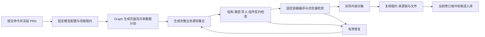

# 原型 P4 模型生成与 Worker 接入

日期：2026-10-29。作者：Andersen。

本轮在 [P3 业务持久化](prototype-persistence-implementation.md) 之上接入真实模型、受限源码生成、P2 容器构建与浏览器验证、不可变对象引用及修订入库。工作台原型操作界面属于 P5，恢复、人工确认和导出属于 P6；本轮不把生成成功视为人工需求确认或整个第一阶段交付完成。

## 执行链路



`PrototypeGenerationRunner` 实现 P3 的 `PrototypeExecutionGateway`。提交事务只读取模型配置和后台探测缓存，提交成功后才派发执行；整个进程只有一个执行槽，不排无限队列。不可用或忙碌时，生成接口返回 `503 / PROTOTYPE_RUNNER_UNAVAILABLE`，不创建业务记录。两个请求同时竞争执行槽时，已提交但未取得槽的任务明确失败，不会永久排队。

后台每 30 秒在启用真实模型配置时探测 Docker 与固定工具链，成功缓存有效期为 90 秒。能力探测不调用模型、不下载镜像、不安装依赖。首次启用模型或准备工具链后，最多等待一个探测周期。普通联调模式不提供原型假生成。

领取后固定一个 `PrototypeModelProvider.Session`，在该任务内保持平台、模型和凭证一致。`PrototypeWorkflow` 使用 Spring AI Alibaba Graph 编排计划、计划校验、源码生成和输出校验。Graph State 使用 JSON 文本跨越复杂对象复制边界；凭证客户端、执行令牌和完整调用上下文只在调用期私有注册表中存在，不是 Graph 检查点。

执行器每 10 秒独立续租，模型或 Worker 调用不会阻塞心跳。P3 的 2 分钟心跳失联上限和 15 分钟任务总预算继续生效，旧租约失效会中断外部调用。应用关闭打断正在执行的任务；下一次启动将遗留任务中断，不自动重放。

## 模型与文件契约

生产模型复用现有系统设置中启用的配置和后端加密密钥，不新增前端凭证入口。`PrototypeModelRuntime` 的来源固定为 `live/model`；合成测试替换整个模型接口并明确使用 `synthetic/test-fixture`。固定人员样板继续使用 `demo/trusted-fixture`，不会被绑定到任意 PRD。

模型先返回声明式计划，再返回完整生成文件集合及受限补充用例：

- 计划精确覆盖冻结 `scope.pageRefs`，以 `moduleId + pageId` 识别页面。P4 当前每个选中页面提供一条独立路由；表单可复用弹层组件。动态路由必须提供固定模拟 ID 的 `testPath`，且不能直接作为菜单入口。
- 文件仅允许 `src/features/generated/`、`src/mock/generated/` 中的 `.vue/.js/.json`。平台维护路由、应用壳、组件、构建配置及依赖锁。最多 100 个文件，单文件 256 KiB，全部源码 5 MiB；超量失败，不截断。
- 输出必须是严格 JSON，拒绝重复键、尾随内容、未知命令字段、重复路径及仅大小写不同的文件。Worker 进一步检查真实导入闭包、Vue SFC、组件白名单及资源引用。
- 补充用例只有 `click / fill / assertText / assertVisible`，使用稳定 `data-testid`；`fill` 支持 input/textarea。最多 20 用例、每例 20 步、全部 100 步。模型不能提交 JavaScript、任意选择器或自报通过状态。
- 共享实体保存在生成区内存模块，列表、详情、编辑使用同一实体集合；刷新或平台重置恢复种子。业务数据库只保存原型源码修订，不接收模拟 CRUD 数据。

单次模型调用上限 180 秒，输入 12 MiB、输出 8 MiB；请求不自动重试。共享模型 HTTP 适配增加 10 秒连接、180 秒响应、16 MiB 实际响应体限制，并禁止凭证随重定向发送。旧需求分析复用这些传输限制，平台协议路径及模型参数保持既有行为。

格式、源码、编译和浏览器检查失败最多自动修复两轮，与初次生成共用总任务预算；网络、凭证、工具链和超时故障直接失败，不用修复循环掩盖环境问题。已有合法计划时修复固定该计划；尚未得到合法输出时可重新生成计划。内部诊断有界、只回馈当次修复调用；数据库和公开任务保留固定安全分类，不保存模型原文或编译日志。

## 编辑、同步与持久化

`GENERATE` 从冻结 PRD 生成完整选中范围。`EDIT` 从领取时确定的基准修订读取已封存生成区文件，先验证整个对象，再重验实际读回文本的摘要；引用原来源快照，不能暗中采纳后来 PRD 的变化。`SYNC_PRD` 冻结新 PRD，带入旧源码及全范围要求，对完整新范围重新构建和验证。

P4 的模型输出采用“生成区完整集合”契约；不要求模型直接维护文件摘要补丁。固定基准、完整集合替换和事务锁共同确定增加、修改、删除的实际结果。平台文件不属于该集合。编辑时文件及计划/用例均未变化，任务成功但不构建、不创建空修订；同步则仍须记录新来源。

Worker 通过固定 Node 程序及 `build-generated` 命令接收 stdin JSON，不使用 shell。Java 清理继承环境，只传递 Node/Chromium 定位所需配置及固定产物根，不向 Worker 传递模型密钥、数据库密码或主密钥。stdout、stderr、输入大小及总等待都有界；取消先发送 SIGTERM，给 Worker 清理其编译进程、浏览器与执行槽的时间，之后才终止残留进程。

Worker 准备阶段核验本机 Vite 依赖与 Chromium。任务在临时工程中编译，每次验证创建独立浏览器上下文。平台检查始终包括全部声明路由、实际业务内容、运行错误、禁止请求及壳重置，模型用例只补充交互。实际检查结果和截图随文件封存。模型的“检查通过”“已保存”文字不能决定状态。

浏览器静态响应采用与 P2 实际预览一致的 CSP、`sandbox allow-scripts` 和 opaque origin 所需 CORS，避免普通 origin 下的验收掩盖实际预览中的动态执行或存储错误。已用真实浏览器证明 `eval`、`new Function`、`localStorage`、`sessionStorage` 四种行为均被拒绝。路由名称由复合页面身份确定，不随计划重排或标题变化；P2 消息协议保持不变，P5 可按具体修订的路由清单映射页面。

成功后 `PrototypeArtifactStore` 再验证内容对象和每个文件，P3 短事务写入修订、任务终态及消息。原型或输入锁变化时保留候选，不覆盖当前稿。生成失败、修复耗尽、中断和损坏基准均保留上一可用修订。业务当前指针仍在 PostgreSQL，Worker 不更新 P2 的 `current.json`。

## 配置与运行

从仓库根目录启动。后端配置集中在 `application.yaml`：

| 环境变量 | 默认值 / 作用 |
| --- | --- |
| `ALPHA_PROTOTYPE_GENERATION_ENABLED` | `true`；入口开关，仍须真实模型和 Worker 可用 |
| `ALPHA_PROTOTYPE_ARTIFACT_ROOT` | `./data/prototypes`；Java 与 Worker 共用的封存根 |
| `ALPHA_PROTOTYPE_NODE` | `node`；受信 Node 可执行程序 |
| `ALPHA_PROTOTYPE_WORKER_DIR` | `./prototype-worker`；应用版本对应的固定 Worker |
| `ALPHA_PROTOTYPE_TEMPLATE_DIR` | `./prototype-template/zero-admin`；固定组件契约 |

使用已有 `npm run prototype:prepare` 准备工具链，`npm run prototype:doctor` 检查状态。平台 Worker 脚本或模板改变后必须重新 prepare，不能忽略指纹差异。部署需同时提供固定模板、Worker、Node、Chromium 和产物目录。

原型提交、读取、历史和候选应用沿用 P3 接口。P4 没有新增公开的执行回调，也没有开放任意路径、镜像、shell、验证脚本或模型标签参数。

## 验证方式与边界

普通后端测试及 `postgresTest` 不调用真实模型。显式真实验收命令：

```sh
ALPHA_PROTOTYPE_LIVE_TEST=true ./gradlew :backend:prototypeLiveTest --console=plain
```

该测试只读取得后端当前启用模型的密文配置，将其复制到随机 PostgreSQL 测试 schema，用已有后端主密钥在内存解密。它新建一份明确的设备台账 PRD，实际执行首次生成和页面编辑，调用真实模型、本机编译及浏览器、真实文件服务及业务数据库事务。测试结束清理随机 schema，保留内容对象和 `backend/build/reports/prototype-live.json` 安全报告。不会迁移或修改现有业务 schema、已有模型配置、业务项目或当前预览。

验收报告保存 PRD、模型身份、来源摘要、工具链、任务/修订/对象身份、计划、实际检查及未验证项，不含 API Key、密文、平台 URL 或宿主路径。真实模型、合成事务、受控子进程测试和样板证据分别报告。

自动回归包含真实 H2 事务、Graph 复用、首次生成、基准编辑、完整范围同步、无变化、两轮修复、来源冲突候选和中断；模型客户端与 Worker 管道另以真实本机 HTTP/Node 验证时长、字节上限、环境过滤及 SIGTERM 清理。迟到心跳不会中断下一任务，三条阻塞管道使用独立虚拟线程，成功构建刷新能力缓存后可立即接续编辑。

最终实际执行的回归结果如下，均无失败和跳过：

| 验证 | 实际结果 |
| --- | --- |
| 后端 `:backend:test` | 249 项通过；包含 8 项生成事务、10 项 Graph/输出契约、17 项 Worker 实际子进程、2 项迟到心跳、19 项文件存储、7 项模型运行时与 4 项实际 HTTP 边界测试 |
| `:backend:postgresTest` | 31 项通过，使用随机隔离 schema |
| 前端 `npm test` / `npm run build` | 63 项通过，生产构建成功；保留既有 bundle 大小提示 |
| `npm run prototype:test` | 固定模板 5 项、Worker 与预览 29 项通过 |
| 真实 Docker 隔离复验 | 生成合成正例 5 项、旧样板 10 项通过；4 种动态执行/存储负例均被浏览器拒绝，实际 SIGTERM 清理通过 |
| `:backend:prototypeLiveTest` | 1 项真实端到端测试通过，包含下面两次实际模型任务 |

最终后端与 PostgreSQL 回归使用 `JAVA_TOOL_OPTIONS=-Djava.util.concurrent.ForkJoinPool.common.parallelism=2` 执行，实际证明低并发公共线程池不会阻塞新 Worker 管道；这些管道使用自己的虚拟线程。

真实验收第一轮已完成首次生成及入库，使用一次修复并通过 8 项浏览器检查；它发现长任务结束后能力缓存过期会短暂阻塞后续编辑。已修复缓存衔接并补充回归，再进行完整首次生成及编辑复验。该轮未完成后续编辑。

## 真实模型闭环证据

2026-10-29 14:38–14:44（Asia/Shanghai），实际使用后端当前启用的 `gpt-6-sol` 完成首次生成和一次页面编辑，最终 `prototypeLiveTest` 成功，报告状态为 PASSED。没有替换模型、Worker、文件服务或 PostgreSQL。

| 操作 | 任务结果 | 修复次数 | 平台与补充检查 | 修订 |
| --- | --- | --- | --- | --- |
| GENERATE | SUCCEEDED / APPLIED | 1 | 9 项 PASSED | `1651f579-55db-4bce-aeea-fd48ed7e9cd3` |
| EDIT | SUCCEEDED / APPLIED | 0 | 10 项 PASSED | `fe9382c9-c901-42ed-a67a-184ddf797f12` |

两份修订共同引用来源 `03cc1e79-e05a-4a47-8eda-2e20911f1c9e`，第二份修订的 parent 明确为第一份。编辑将列表主标题改为“设备台账（验收编辑）”，再次通过原有全部交互检查，并新增标题断言。真实检查包括两条路由、名称查询与重置/空态、取消副本不修改实体、空名称和负容量失败后保留可编辑表单、保存容量 0 与停用 false、详情同步、详情返回、重置和无运行错误/外部请求。

| 对象 | 内容身份 |
| --- | --- |
| 首次生成对象 | `428dc1fcc5700845eb23bb96f66d450ebb54ecaa3e34d6e9a70eef2edd5b2734` |
| 页面编辑对象 | `203c208a13492ff275acfe676666c35a333df8e3050c35a7ec26c2a84c724664` |
| 固定工具链镜像 | `sha256:ce8c4cc40eead298c42f8d558b826768a3047d72039e49d41d711f45c90f7baf` |

本轮使用的随机业务 schema 已在验收后清理，测试修订不属于现有业务工作台。

模型产物质量以本次具体 PRD 和实际通过用例为限，不能推断任意 PRD 均可一次生成或全部业务语义已验收。本轮未启动新版业务服务、未迁移现有业务 schema、未增加 P5 操作界面，原 P2 样板指针保持不变。
