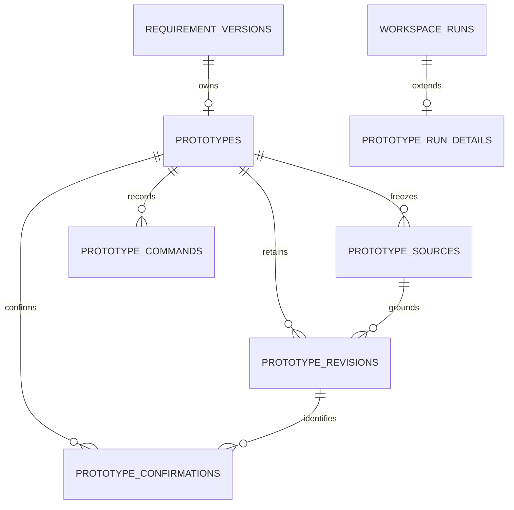
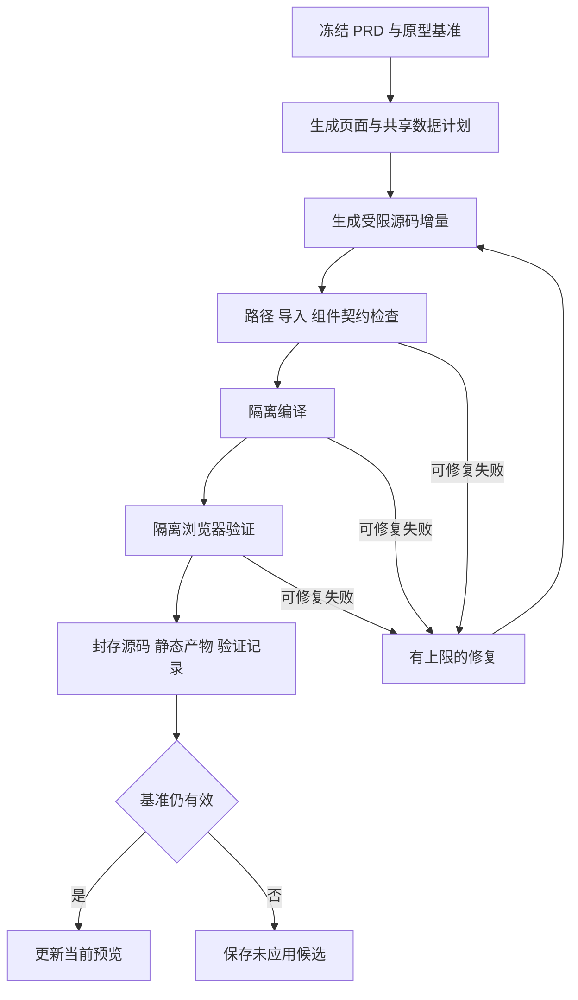

# PRD 原型生成第一阶段设计

日期：2026-10-29。作者：Andersen。状态：P1–P6 已实现，第一阶段原型生成、修订、恢复、确认与导出闭环已接通；实际范围与验收证据见 [P1/P2](prototype-foundation-validation.md)、[P3](prototype-persistence-implementation.md)、[P4](prototype-generation-implementation.md)、[P5](prototype-workbench-implementation.md) 和 [P6](prototype-delivery-implementation.md)。

本阶段为 Alpha 增加“根据 PRD 生成可交互管理端原型”的能力。采用固定版本的 Zero 管理端工程模板，生成受约束的 Vue 业务源码，经隔离构建和浏览器检查后在工作台预览；继续通过会话修改，并保留来源、历史和人工确认记录。

本文定义第一阶段的实施契约。P1 固定模板、P2 本地可信样板构建预览、P3 六表与来源/修订/任务事务、P4 模型计划/源码生成与受控 Worker、P5 工作台入口及受控预览均已接入。P6 已完成恢复、人工确认、源码/静态导出和回收保护，保留真实模型生成与修改、恢复和确认接口、导出重建及独立浏览器验证的完整证据。既有能力以 [当前架构](architecture.md) 和 [统一工作区设计](unified-workspace-design.md) 为准，不能将模板联调或合成事务视为模型生成验收；原型确认仍不表示开发或生产验收完成。

## 1. 已确定的方案与一期范围

### 1.1 核心决定

1. Alpha 工作台继续使用 Vue 3、shadcn-vue、Tailwind CSS；管理端原型独立构建，采用经过裁剪的 Zero Vue / Element Plus 模板。
2. 原型的界面真值为 Vue 源码；轻量清单负责导航、文件归属、来源和验证，不实现通用 UI 配置语言。
3. 模型只生成业务页面、局部组件、模拟数据和受限元数据。依赖、构建配置、外壳、公共组件、预览桥接和验证执行器由平台维护。
4. 允许从已保存的 PRD 草稿试生成；人工确认原型必须绑定有效的 PRD 定稿及明确范围。
5. 会话承担讨论入口，原型归属当前 PRD 文档容器。多个会话共享同一文档时共享原型。
6. 候选先检查再成为当前预览。失败、服务中断或生成基准过期均不得覆盖当前可用版本。
7. 原型模拟业务行为，不访问目标产品真实后端；Alpha 的模型调用仍在后端完成。
8. 任务持久化与 Graph 检查点恢复分离；一期继续采用中断终态和显式重试。

### 1.2 第一期纳入

| 能力 | 一期边界 |
| --- | --- |
| 管理端模板 | 一个内置 `zero-admin@2` 工程模板，独立入口、主题、导航、组件和锁定依赖 |
| 页面类型 | 列表、表单、详情，以及这些页面的弹窗、抽屉和区域组合 |
| 基础交互 | 查询、重置、分页、基本表单校验、模拟新增与修改、详情查看、导航、取消与未保存保护 |
| 业务一致性 | 多页面共享实体、字典及稳定 ID；保存后列表和详情保持一致 |
| 演示状态 | 正常、空数据、加载、失败；PRD 有明确要求时模拟按钮可用性与角色情景 |
| 生成输入 | 当前文档已保存草稿或指定定稿，可选择全部受支持页面或模块、页面子集 |
| 会话调整 | 页面级目标和整个原型目标；必要时联动共享文件及关联页面 |
| 版本能力 | 当前可用稿、不可变修订、候选、历史查看、恢复为新修订、人工确认 |
| 交付 | 固定修订的源码包、静态预览包、来源与验证说明 |
| 可用性 | 刷新后恢复任务查看；失败保留旧预览；重启不自动再次调用模型 |

首个验收场景使用一个包含列表、表单、详情和关联数据的完整业务模块。工具不硬编码“人员管理”，也不限制文档只能有一个模块。现有 [人员管理样板](prd-examples/personnel-management-prd.md) 可作为模板校准材料；其中待确认规则不得默认为正式要求。

一期不默认增加删除、批量操作、导入导出或审批。只有选定 PRD 范围提出且模板明确支持的动作才生成；未支持动作进入能力缺口清单。

### 1.3 后续范围

- 日历、甘特图、关系图及复杂自定义页面的完整支持。
- 任意拖拽编辑、像素级元素选择、开放模板编辑器和模板市场。
- 任意 npm 依赖安装、自由修改外壳、多前端框架。
- 真实业务接口、认证与权限执行、数据库生成、生产部署及开发验收。
- 项目级多 PRD 自动合并、多方案分支、跨文档沿用原型和分布式调度。
- 同一模型任务原子修改 PRD 与原型的联合编排；一期采用关联修改建议和现有 PRD 编辑流程。

遇到范围外页面时先列出缺口，允许用户选择受支持子集继续；不静默改成普通列表，也不把部分成功显示为全文完成。新依赖或新页面范式通过模板开发扩展。

## 2. 使用流程与阶段规则

### 2.1 首次生成

1. 在统一工作区切换到“原型”，显示空态与“生成原型”。GET 查询不隐式创建原型或会话。
2. 提交前刷完 PRD 自动保存队列，展示草稿/定稿来源、生成范围和模板；默认优先当前有效定稿，无定稿时使用已保存草稿。
3. 服务端重新校验来源和范围，冻结完整 PRD 及相关上下文，保存用户消息和任务，再开始模型调用。
4. 生成页面关系、共享实体和文件计划。正常默认交互直接采用；影响业务含义的未知项列为阻塞或探索假设。
5. 生成源码与模拟数据，完成文件检查、编译和浏览器验证。最多进行两轮自动修复，不无限重试。
6. 检查通过且来源、工作稿未变化时自动成为当前可用稿；否则保存可运行候选，并显示未应用原因。
7. 页面展示实际生成模式、范围和未实现项。生成成功不自动确认原型。

探索假设与正式 PRD 要求分别记录。非阻塞的布局默认值可预览；业务关键规则缺失时不得编造“真实成功”行为，相关操作明确不可用或标记为演示假设。

### 2.2 预览与会话修改

工作台保留 PRD / 原型视图、可收起的会话、来源与历史入口。原型默认体验模式，提供独立窗口和重置模拟数据；一期讨论目标为页面或弹层的稳定标识，不要求实现任意 DOM 节点拾取。

- 视觉调整只改变原型。字段、权限、业务规则变化形成关联 PRD 修改建议，不能静默改写正式需求。
- 一期用户明确要求两者一起改时，按现有 PRD 编辑流程先处理并保存需求，再执行已授权的原型同步命令；无需重复审批，界面分别报告两个结果，不宣称跨任务原子成功。前一步失败时不继续同步。
- 编辑任务读取当前原型源码、目标页面、相关共享文件、PRD 来源及模板契约，输出文件变化和影响清单。P4 具体采用生成区完整集合，由平台相对固定基准确定变化；模型不维护宿主路径或文件摘要补丁，未改文件也必须保留。
- 纯原型编辑继续基于原型原有 PRD 快照；需要采用新 PRD 时使用 `SYNC_PRD`，不能悄悄替换来源。
- 页面改名保留 ID。PRD 页面、路由、弹层和区域允许多对多映射，名称和数组下标不能充当身份。
- 未列出的文件原样保留；删除必须显式声明。共享实体或组件变化后，关联页面一起验证。

### 2.3 草稿、定稿与交付阶段

PRD 和原型各自控制草稿与确认状态。当前直接 PRD 流程依赖 `stage=PRD` 的保存、迟到结果和前端编辑判断，需要共同改造，不能只放开前端按钮。

一期规则如下：

- 直接 PRD 模式通过当前 PRD 是否开放编辑、归档/删除/取消状态及修订锁判断可写性；继续编辑保留全部历史定稿。
- 进入 `PROTOTYPE` 后该阶段作为已到达的里程碑保留。再次编辑 PRD 不使已有原型消失，也不以阶段枚举禁止 PRD 草稿操作。
- 原型草稿可以在 PRD 草稿阶段试生成。原型是否可编辑由原型、文档和项目状态决定。
- 原型确认后仍保留 `PROTOTYPE`，显示“原型已确认，开发与验收未接入”；不新增虚假的已完成交付状态。
- 未转换的旧 REVIEW 流程继续沿用原门槛；一期仅扩展已进入 `directPrd` 的统一工作区。

原型确认必须同时满足：当前修订可用、选择范围覆盖完整、必要交互检查通过、阻塞事项清零、绑定当前有效 PRD 定稿且相关输入指纹一致、没有执行中任务。确认范围必须与当前修订的 `manifest.scope` 完全一致；“子集确认”指该原型修订本来只覆盖 PRD 子集，不能表示整个文档已完成，也不在同一修订内再维护部分确认状态。

草稿来源的原型需先通过 `SYNC_PRD` 对齐定稿再确认。相同内容可复用已有文件与构建产物，但必须形成新的来源记录和原型修订，不修改旧来源。

## 3. 工程与模板边界

### 3.1 建议目录

```text
frontend/src/api/prototypes.js             工作台原型 API
frontend/src/components/prototype/         预览、任务、来源、历史
backend/.../prototype/                     Controller、应用服务、契约、仓储
backend/.../agent/PrototypeWorkflow.java    生成与校验阶段编排
prototype-template/zero-admin/             固定原型模板与来源记录
prototype-worker/                          构建、验证及隔离执行适配
docs/prototype-phase-one-design.md         本设计
```

生成工程、任务临时文件与静态产物放在后端配置的专用 `data/prototypes/` 下，不混入源码目录，不为每个原型创建 Git 仓库。根目录统一提供构建入口；新增 Worker 的准备、启动与健康检查命令在实现时加入 README。

### 3.2 Zero 采用方式

P1 已采用 Zero 正式提交 `6e07bd5a78804b26ad2904c151e2bf3470631c4c`，其发布元数据标记 `zero-v3.2.1`，并通过 Zero 基线同步工具的规划器核验远端 `origin/master` 来源。采用范围限定为 `prototype-template/zero-admin/`，来源文件、摘要、适配规则与基线已记录在该目录；Alpha 工作台不在此次采用范围内。

后续升级继续用 Zero 基线同步工具核验来源、资产范围和适配契约；采用记录只放在原型模板应用范围。模板必须包含精确来源、模板版本、依赖锁、工具链标识及文件摘要，避免运行时依赖开发机的 Zero 绝对路径。

保留所需布局、主题、表格、查询、CRUD、反馈组件及其真实依赖。提供原型专用入口、静态菜单、模拟身份和模拟数据适配；移除默认 OAuth 守卫、账号门户、真实菜单请求及构建认证配置前提。不复制 Zero 环境文件和目标业务模块。

新模板版本只供新建或显式迁移使用。第一期无模板迁移 UI；既有原型继续使用原版本。

### 3.3 模板契约

| 字段 | 含义 |
| --- | --- |
| `id` / `revision` | 如 `zero-admin` / `1`，不可变模板身份 |
| `sourceCommit` / `bundleSha256` | 上游精确来源与已裁剪模板包校验值 |
| `toolchainId` / `lockSha256` | Node、构建器和验证驱动固定版本及依赖锁摘要 |
| `supportedPageTypes` / `supportedActions` | 实际经过样板验证的页面与交互能力 |
| `writablePaths` / `allowedImports` | 生成文件范围及可引用模块，匹配到具体入口 |
| `componentContracts` / `examples` | 组件输入、事件、组合约束与最小参考源码 |
| `validationProfile` / `limits` | 平台验证配置及资源限制 |

模型可写目录限定为 `src/features/generated/` 和 `src/mock/generated/`，可生成 `.vue`、受限 `.js`、`.json` 文件。路由、菜单入口由平台根据清单确定性组装；不允许输出或覆盖 `package.json`、锁文件、Vite 配置、入口、平台验证脚本、预览桥接或公共组件。

导入扫描、目录限制属于输入检查，不替代执行隔离。正文、标签、提示等外部文本仍按文本显示，禁止用 `v-html` 注入；生成代码只在独立原型执行边界内运行。

## 4. 业务数据结构

### 4.1 归属与对象关系

现有 `requirement_versions.id` 在统一工作区承担文档容器身份。第一期不改变其含义，不自动合并同项目其他 PRD。



第一期新增六张表，复用 `workspace_runs` 和 `session_messages`。ID 使用现有字符串 UUID，时间使用 `timestamptz`，修订与大小使用 `BIGINT`；JSON 快照沿用现有 TEXT + ObjectMapper 序列化方式，跨对象引用、状态和查询字段单列。

### 4.2 `prototypes` 原型聚合

| 字段 | 约束与职责 |
| --- | --- |
| `id`、`project_id`、`version_id` | 主键；`version_id` 唯一；文档与项目通过复合外键保持同项目归属 |
| `revision` | 聚合并发锁，从 1 开始；提交任务、应用候选、恢复和确认等状态变化递增 |
| `next_revision_number` | 分配不可变原型修订序号，项目锁内递增；不是聚合并发锁 |
| `current_revision_id` | 当前可用工作稿；首次生成完成前为空，只指向同原型可用修订 |
| `latest_confirmation_id` | 最近人工确认记录，可空；当前稿改变时保留历史引用，不代表新稿已确认 |
| `template_id`、`template_revision` | 首次创建固定的模板引用，一期不原位切换 |
| `created_at`、`updated_at` | 聚合生命周期时间 |

不复制文档删除/归档/取消字段；读写资格从所属文档、项目和发起会话判断，避免两套状态漂移。原型首次在显式生成命令事务中创建。

### 4.3 `prototype_sources` 不可变 PRD 输入

| 字段 | 约束与职责 |
| --- | --- |
| `id`、`prototype_id`、`version_id` | 身份及归属，须与原型文档一致 |
| `source_kind` | `DRAFT` / `BASELINE` |
| `prd_revision`、`lifecycle_revision`、`version_revision` | 读取时的正文修订、产物聚合锁和文档锁，各自保留原含义 |
| `prd_baseline_id` | 定稿来源必填，草稿来源为空；只能引用同文档 `kind=PRD` 基线 |
| `prd_json` | 完整 PRD 快照，包含其写作模板引用；不只保存当前页面 |
| `context_json` | 实际用于生成的项目背景及其修订、写作模板精确定义和有界补充说明，不含凭证 |
| `scope_json` | 选定的模块、页面稳定 ID、选择方式及有序覆盖清单 |
| `fingerprints_json` | 全局规则、模块、页面、关联依赖的规范化摘要，用于影响判断 |
| `content_sha256` | 上述实际输入的规范化摘要，排除抓取时间和不相关展示元数据 |
| `created_at` | 冻结时间 |

旧原型不通过“当前 PRD 指针”回读内容。输入 JSON 对象键排序、数组保持业务顺序、文本不擅自压缩空白；摘要算法与规范化版本写入快照，升级算法不能让旧记录被错误判为相同。

### 4.4 `prototype_revisions` 不可变可运行修订

| 字段 | 约束与职责 |
| --- | --- |
| `id`、`prototype_id`、`revision_number` | 主键；`(prototype_id, revision_number)` 唯一 |
| `parent_revision_id`、`restored_from_revision_id` | 编辑基准及恢复来源，均只引用同原型；首次生成为空 |
| `source_id`、`source_run_id` | 固定来源与生成任务；人工恢复没有新的模型任务 |
| `template_id`、`template_revision`、`toolchain_id` | 精确复现依据，与所用模板包一致 |
| `manifest_json` | 页面、来源、文件归属、依赖、行为、覆盖及模拟数据清单 |
| `validation_json` | 平台实际执行的检查、结果、未检查项和诊断摘要 |
| `artifact_json` | 源码包、静态包及可选截图的对象键、SHA-256、字节数；不含宿主绝对路径 |
| `mode`、`model`、`change_summary` | 实际来源和变更说明；恢复沿用来源并明确人工恢复 |
| `created_at` | 产物封存时间 |

此表只写入已通过规定运行检查的完整修订。失败工作文件留在任务临时区及受限诊断中，不伪装成可运行历史。可运行但并发过期的候选也进入此表，通过任务应用状态区分是否成为当前稿。

`current_revision_id`、父修订、恢复来源、来源与确认引用使用同聚合复合外键或等价约束；不得仅凭客户端提供的 ID 认定归属。

### 4.5 `workspace_runs` 与 `prototype_run_details`

复用任务表，新增 `kind=PROTOTYPE`。`workspace_runs` 继续保存项目、会话、文档、请求 ID、用户输入、模式、模型、状态、安全结果和时间。其 `draft_revision` 在该种类中约定为提交时 PRD 产物聚合修订，与现有 WORKBENCH 口径保持一致，不能冒充原型修订。

原型任务扩展表与 `workspace_runs` 一对一：

| 字段 | 约束与职责 |
| --- | --- |
| `run_id`、`prototype_id`、`source_id` | 任务主键及原型、固定输入引用 |
| `operation` | `GENERATE` / `EDIT` / `SYNC_PRD` |
| `base_revision_id`、`expected_prototype_revision` | 固定的原型基准和应用前置锁；首次生成为空基准 |
| `expected_prd_revision`、`expected_lifecycle_revision`、`expected_version_revision` | 提交时当前文档状态，用于识别任务期间变化；不一定等于旧原型来源修订 |
| `command_hash` | 规范化完整命令摘要，覆盖来源、目标、模板、输入和修订 |
| `target_json`、`plan_json` | 稳定讨论目标、最终生成计划与影响范围 |
| `phase` | `PREPARING` / `PLANNING` / `GENERATING` / `BUILDING` / `VERIFYING` / `PERSISTING` / `FINISHED` |
| `repair_attempts` | 已使用自动修复次数，最多 2 |
| `execution_token`、`heartbeat_at` | 执行租约及心跳；防止中断后旧 Worker 写回 |
| `result_revision_id` | 可运行结果，可空；不直接等于当前稿 |
| `application_status` | `PENDING` / `APPLIED` / `CONFLICT` / `NOT_APPLICABLE` |
| `diagnostic_json` | 脱敏且限长的失败分类、检查结果、诊断编号与临时产物引用 |
| `retry_of_run_id` | 显式重试来源，可空 |

`context_text` 只保留有界说明及不可变来源引用；公开任务响应不返回完整上下文、模型原始响应或任意文件路径。`result_text` 保留安全结果摘要及修订 ID，避免塞入整份源码。

任务分发必须显式区分种类。既有 `WorkspaceService.execute`、WORKBENCH 消息结果读取和错误展示不得把 `PROTOTYPE` 误作 DRAFT 或忽略。会话消息继续使用已有 `run_id` 关联，不另建原型消息表。

### 4.6 `prototype_confirmations` 人工确认

| 字段 | 约束与职责 |
| --- | --- |
| `id`、`prototype_id`、`revision_id` | 确认身份和同原型精确修订 |
| `prd_baseline_id`、`scope_json` | 当时有效 PRD 基线和确切确认范围；须与修订来源、覆盖一致 |
| `request_id`、`command_hash` | 同原型幂等键及完整命令摘要，`(prototype_id, request_id)` 唯一 |
| `created_at` | 人工确认时间 |

不扩展旧 `version_artifact_baselines.kind` 来塞入源码产物；该表保留 REVIEW/PRD 语义。原型确认单独建模，通过文档来源连接。保存、生成、恢复、下载均不能创建确认记录。

### 4.7 `prototype_commands` 应用与恢复幂等记录

| 字段 | 约束与职责 |
| --- | --- |
| `id`、`prototype_id` | 命令身份与归属 |
| `kind`、`request_id`、`command_hash` | `APPLY` / `RESTORE`；`(prototype_id, kind, request_id)` 唯一，摘要覆盖目标及预期锁 |
| `target_revision_id`、`result_revision_id` | 同原型输入与结果修订；应用指向原候选，恢复指向新追加修订 |
| `result_json`、`created_at` | 最小结果快照及执行时间，用于返回原命令结果 |

控制命令与聚合修改在同一短事务中写入，不调用模型，不经 QUEUED 状态。应用候选只变更聚合指针及任务应用状态，不修改候选内容或创建重复生成修订；恢复创建新修订，`source_run_id` 为空，通过恢复来源追溯原生成任务。失败事务不留下成功命令记录。

生成使用任务表幂等，确认使用确认表幂等；不把多次应用事件塞进不可变修订。`prototype_revisions.source_run_id` 对非空值唯一，保证一个生成任务只封存一个结果。

### 4.8 清单结构示例

下例表达结构，摘要和示例路径由平台实际生成。标识均为文档内稳定 ID；页面来源和路由并非一一对应。

```json
{
  "schemaVersion": 1,
  "scope": {
    "mode": "SELECTED",
    "pageRefs": [
      {"moduleId": "personnel", "pageId": "personnel-list"},
      {"moduleId": "personnel", "pageId": "personnel-form"},
      {"moduleId": "personnel", "pageId": "personnel-detail"}
    ]
  },
  "pages": [
    {
      "id": "personnel-list-view",
      "route": "/personnel",
      "entry": "src/features/generated/personnel/PersonnelList.vue",
      "sourceRefs": [
        {"moduleId": "personnel", "pageId": "personnel-list", "sectionKeys": ["fields", "search"]}
      ],
      "overlays": [
        {"id": "personnel-edit", "sourcePageId": "personnel-form", "kind": "drawer"}
      ],
      "entityIds": ["person", "department"]
    }
  ],
  "entities": [
    {"id": "person", "keyField": "id", "seedFile": "src/mock/generated/personnel.json"},
    {"id": "department", "keyField": "id", "seedFile": "src/mock/generated/departments.json"}
  ],
  "coverage": [
    {"moduleId": "personnel", "pageId": "personnel-list", "status": "IMPLEMENTED"},
    {"moduleId": "personnel", "pageId": "personnel-form", "status": "IMPLEMENTED"},
    {"moduleId": "personnel", "pageId": "personnel-detail", "status": "PENDING"}
  ],
  "assumptions": [],
  "unsupported": []
}
```

P3 已确认现有 PRD 页面 ID 仅在模块内唯一，因此范围、覆盖、讨论目标和页面指纹统一使用 `(moduleId,pageId)` 复合身份；不要求已有文档重命名页面。`ALL` 在冻结时展开成有序 `pageRefs`，后续不依赖当前正文重新解释旧范围。

完整清单还须包含：

- `files[]`：相对路径、内容 SHA-256、字节数、所属页面/共享实体和生成来源。文件摘要由服务器计算。
- `dependencies[]`：页面对共享文件、实体及 PRD 全局/模块章节的依赖，用于影响扩展。
- `verificationCases[]`：受限的动作与预期值，例如打开页面、填写字段、点击动作、断言可见文本/记录值；不允许 JS、正则脚本或任意网络命令。
- `decisions[]`：明确要求、模板默认值、探索假设的分类与来源。

`sectionKeys` 必须解析为该 PRD 实际模板下的合法章节键；示例不能成为新业务的硬编码字段。`PENDING` 和 `UNSUPPORTED` 阻止相应范围确认。模型自报 `IMPLEMENTED` 只是覆盖声明，必须结合平台检查和人工审阅。

源码增量结构为 `operations[]`，每项只允许 `CREATE`、`REPLACE`、`DELETE`，包含 `path`、已有文件的 `expectedSha256` 和必要的 `content`。平台校验重复路径、基准哈希、允许目录和总量后应用；不运行模型输出的 shell 补丁。

## 5. 状态、并发与来源变化

### 5.1 状态分别表达

| 维度 | 值与解释 |
| --- | --- |
| 任务状态 | 沿用 `QUEUED / RUNNING / SUCCEEDED / FAILED / INTERRUPTED`；成功说明结果通过运行检查，或经核对本轮无变化，不表示人工确认 |
| 候选应用 | 扩展表 `application_status`，成功任务也可能因基准变化未应用 |
| 当前产物 | 无当前修订为 `EMPTY`；当前修订等于最近确认引用，且有效 PRD 定稿、来源和内容资格仍一致时为 `CONFIRMED`，否则为 `DRAFT` |
| 来源新鲜度 | `CURRENT / STALE / REVIEW_REQUIRED`；比较内容、共享依赖、背景及范围，不能只比较页面标题 |
| 检查状态 | 每项 `PASSED / FAILED / NOT_RUN`；未执行不能写成通过 |

来源为草稿/定稿、生成方式为 demo/真实模型、业务动作为模拟执行分别显示。定稿来源即使正文未变化但当前 PRD 已重新开放编辑，也不能显示为当前有效确认依据。

### 5.2 提交与完成事务

1. 在现有项目根锁内确认请求对象存在、稳定归属与读取资格；命令摘要基于提交的原始语义生成，不因当前模板或正文变化而重算为另一条命令。
2. 按 `(session_id, request_id)` 先查幂等。相同命令返回已有任务；同键不同 `command_hash` 返回 409。命中幂等后不再用当前修订拒绝原请求，且不再次执行副作用；未命中才检查可变状态、模板及输入修订。应用、恢复和确认采用相同顺序。
3. 一期沿用同项目最多一个模型任务的限制，统一检查工作空间与旧 PRD 任务；普通人工 PRD 编辑仍可发生，迟到结果通过修订检测保护。
4. 冻结来源，创建聚合（若尚无）、消息、任务和扩展行，递增原型聚合锁；扩展表记录本任务提交后的预期锁。提交后才派发执行。
5. 模型、构建、浏览器验证和文件写入均在数据库事务外执行。
6. 文件封存并校验后重新锁项目，核对任务状态、执行令牌及对象仍可写；写入不可变修订。
7. 当原型基准及提交时文档锁仍一致时，更新当前稿指针、递增聚合锁并将应用状态置为 `APPLIED`；否则保留候选为 `CONFLICT`。
8. 修订、指针、任务终态和助手结果消息在同一短事务中落库。不能根据模型回复中的“保存成功”决定状态。

候选显式应用也检查当前聚合修订和来源。仅原型基准不同，可提示将候选整体设为当前稿并记录影响；PRD 已变化的候选需先同步或重新生成，不能伪装为最新来源。界面在操作前展示被替换版本及变化范围。

模型未产生文件或有效元数据变化时返回明确无变化结果，任务可成功但 `result_revision_id` 为空、`application_status=NOT_APPLICABLE`，不制造空修订。

### 5.3 重试、中断与恢复

- 网络重传复用请求 ID，不重复执行。用户明确重试使用新请求 ID，记录 `retry_of_run_id`；若输入或修订已变，要求基于当前状态重新提交，不能声称复跑同一输入。
- 服务重启把未结束任务转为 `INTERRUPTED`，使旧执行令牌失效；晚到 Worker 结果不得推进当前指针。
- Worker 心跳和有界超时负责终止失联执行。终态任务不接受新的成功回调。
- 历史恢复读取原修订完整文件与产物，校验存在和摘要后追加一个新修订，记录 `restored_from_revision_id`，不把旧历史改写为当前内容。
- 恢复保留原来源，可能显示 `STALE`；不恢复人工确认状态。缺失或损坏产物返回错误，不静默用其他版本替代。

### 5.4 PRD 影响与回收

PRD 页面变化至少影响对应实现；共享实体、模块规则、全局约定、项目背景变化扩大到依赖页面。新增/删除页面必须明确列入差异。依赖无法可靠判断时标记 `REVIEW_REQUIRED` 并保守检查全部选定范围，不把无证据的语义推断当成完整覆盖。

`SYNC_PRD` 固定新的完整输入，复用未受影响文件，对全部受影响页面执行更新，并验证当前原型的完整选定范围；通过后一次封存到同一新来源。若用户只选中部分受影响页面，服务端须列明并纳入其依赖影响闭包；无法完成整个闭包时保留旧稿并报告失败或能力缺口，不应用混合来源的半成品。一期不维护逐页面多来源工作稿，也不支持跨任务累积未完成同步批次。

删除文档时原型随文档只读隐藏、全部修订和文件保留；恢复文档后原型恢复可见。删除某个会话而文档仍存在时，其他关联会话继续访问同一原型。运行中原型任务参与现有会话、文档、项目删除/归档和取消保护。历史预览链接打开时重新检查父对象状态，不能绕过回收或取消写入限制。

## 6. 构建、预览与文件存储

### 6.1 执行流程



一期默认采用本机容器化 Worker；运行提供方需通过能力探测和隔离测试后才可用，不可用时返回明确环境缺口，不降级为裸宿主执行。该运行依赖尚未在当前环境验证，见第 11 节。

可信模板依赖在准备阶段按锁文件安装并形成固定工具链/镜像；任务阶段不安装依赖、不执行生成的安装脚本、不下载插件。模型调用由 Java 发起，Worker 接收文件和执行配置，不持有模型密钥。

### 6.2 隔离与验证契约

- 构建与浏览器任务仅挂载任务目录和只读工具链，使用非特权身份，限制 CPU、内存、进程、时长和输出；不挂载整个仓库、宿主 `.env`、数据库连接或容器控制套接字。
- 构建网络默认关闭；浏览器只允许访问任务自身的预览资源，不访问外部网络、Alpha API 或宿主服务。
- 校验绝对路径、`..`、符号链接、特殊文件、压缩包路径逃逸、重复路径、非法导入和超量文件。模型不能提交任意可执行验证脚本。
- 浏览器验证由平台维护的执行器解释受限用例，包含路由加载、运行错误收集及模板基础动作；模型用例只是补充，不能自行决定全部通过。
- 独立预览服务只暴露选定静态产物。使用与 Alpha 不同源的地址、受限 iframe、CSP、无凭证请求和有限 `postMessage` 协议；不提供到真实业务服务的通用代理。
- 预览入口使用短期、仅限一个修订的服务端预览会话。服务每次解析页面与资源请求时检查会话有效性及父文档读取资格，过期或状态改变时撤销；回收站只读预览须通过明确的只读入口重新申请。不得直接公开永久产物目录。已加载页面无法收回浏览器内存，但后续访问必须受控。
- 消息只允许 `READY / NAVIGATED / SELECT_PAGE / ERROR` 等固定类型，校验源窗口、预期 origin 或 sandbox 会话令牌、修订身份和载荷结构。不能传任意代码或执行命令。
- 独立窗口采用相同受限内容与策略。浏览器预览校验与用户预览均不能直接在 Alpha 主应用编译执行模型模板。

普通 iframe 地址或不同端口本身不足以证明隔离。实现必须验证父窗口访问、浏览器存储、网络、Cookie 以及导航限制；若启用 `allow-same-origin` 等能力，要以独立 origin 和相应验证保证边界。

### 6.3 初始资源限额

以下为第一期工程默认值，可由后端配置调整，属于实现建议而非已测性能承诺：

| 项目 | 初始限制 |
| --- | --- |
| 原型范围 | 单个原型覆盖最多 10 个 PRD 页面，含关联影响闭包；超限需缩小范围或明确调整配置，不能静默截断或留下跨批次半成品 |
| 生成文件 | 最多 100 个，单文件 256 KiB，总文本 5 MiB |
| 自动修复 | 最多 2 轮，和初始生成共用任务总预算 |
| 执行时限 | 单次模型调用 180 秒、单次编译 120 秒、单次浏览器验证 120 秒、任务执行总计 15 分钟 |
| Worker | 默认同时运行 1 个任务；单任务 2 CPU、2 GiB 内存、进程上限 128 |
| 文件产物 | 单任务静态文件合计 50 MiB、受限诊断日志 1 MiB；平台截图最多 20 张、合计 20 MiB |

所有限制在执行边界实际强制。达到限制产生安全错误并保留旧预览，不能把被截断源码视为完整结果；资源不足不计为模型语义错误。

### 6.4 存储与一致性

业务归属、输入快照、清单、修订和确认放在 PostgreSQL。源码、静态包和截图放在专用产物目录，以内容摘要或服务生成的对象键引用。

1. Worker 输出先进入任务临时区。
2. 平台检查文件和摘要，再封存到不可变对象目录，准备完毕后不可继续修改。
3. 确认对象存在后写数据库引用与当前预览指针。
4. 数据库事务失败只会留下未引用对象；重试按摘要复用，不创建指向半成品的记录。
5. 一期只清理超时临时目录；已引用对象不自动清理。孤立对象后续按引用核对和保留期处理，不与文档软删除绑定。

备份必须同时包含数据库与产物目录。下载与预览只接受产物/修订身份，不接收客户端文件系统路径。对象键、未验证模型内容不能拼接为宿主路径。

模拟数据只在单次预览内存中变化，刷新或“重置演示数据”恢复固定种子。不会写回业务库，也不会改变原型源码修订。跨页面使用同一实体存储，ID 使用字符串并保留 `0`、`false` 和空字符串的业务含义。

源码包包含必要模板、生成源码、锁文件、模拟数据、来源清单、许可证/归属说明与启动说明，不包含 `node_modules`、私有配置或宿主路径。静态包包含确切已验证产物和限制说明，不保证直接以 `file://` 打开，提供静态 HTTP 服务启动说明。导出的是原型实现，不标注为生产交付完成。

## 7. API 与分层契约

统一前缀 `/api/alpha/workspace`，继续使用 `{code,message,data}`。列表沿用有界分页。第一期所有生成命令要求已有同文档关联会话；原型状态、历史和下载可从文档入口读取。

| 方法与路径 | 主要输入/输出 |
| --- | --- |
| `GET versions/{id}/prototype` | 原型存在性、聚合锁、当前修订、确认、来源状态、能力缺口及安全任务摘要 |
| `GET prototype-templates` | 可用模板版本、支持页面和动作、环境可用性；无密钥或宿主路径 |
| `POST versions/{id}/prototype/runs` | 生成、编辑或同步命令；返回 202 和持久化任务 |
| `GET runs/{id}` | 沿用通用安全任务状态，扩展原型阶段、结果修订及应用状态 |
| `GET versions/{id}/prototype/revisions` | 分页修订目录，区分当前、已确认和候选 |
| `GET versions/{id}/prototype/revisions/{revisionId}` | 清单、来源、验证、预览可用性；源码按导出获取 |
| `POST versions/{id}/prototype/apply` | 显式应用可运行候选；携带来源任务、目标修订、原型及文档预期锁 |
| `POST versions/{id}/prototype/restore` | 指定历史修订、预期原型锁和请求 ID，恢复为新修订 |
| `POST versions/{id}/prototype/confirm` | 当前修订、PRD 基线、原型/文档/产物预期锁、请求 ID |
| `GET versions/{id}/prototype/confirmations` | 分页人工确认历史 |
| `POST versions/{id}/prototype/revisions/{revisionId}/preview` | 检查归属与父对象状态，返回受限预览入口和桥接会话信息 |
| `GET versions/{id}/prototype/revisions/{revisionId}/export?format=source\|static` | 下载固定修订；导出不创建确认或调用模型 |

生成命令必须包含 `sessionId`、`requestId`、`operation`、`expectedVersionRevision`、`expectedLifecycleRevision`、`expectedPrdRevision`、`expectedPrototypeRevision`、`baseRevisionId`、`source`、`scope`、`target` 和 `content`。原型聚合尚不存在时预期锁为 0、基准为空；首次失败后已存在空聚合，重新生成必须使用其实际锁值。已有当前稿时同时匹配聚合和基准。首次选择模板，后续从聚合读取，不接受偷偷切换模板。

- `GENERATE`：首次创建完整选定范围；已有稿不允许无提示地再次从空壳生成。
- `EDIT`：以当前稿及其来源快照修改；`source` 固定为已有来源引用。
- `SYNC_PRD`：选择新的草稿/定稿快照及目标范围，计算差异并更新或追加页面。

恢复和应用命令使用 `prototype_commands`，重复请求返回原命令结果，不修改不可变修订。确认使用独立确认表的幂等约束。新请求恢复到已为当前稿的完全相同目标可以返回明确无变化结果，仍写入控制命令以保证重传一致。

错误类别至少区分 `PROTOTYPE_REVISION_CONFLICT`、`PROTOTYPE_SOURCE_CHANGED`、`PROTOTYPE_UNSUPPORTED_SCOPE`、`PROTOTYPE_RUNNER_UNAVAILABLE`、`PROTOTYPE_FILE_REJECTED`、`PROTOTYPE_BUILD_FAILED`、`PROTOTYPE_PREVIEW_FAILED`、`PROTOTYPE_ARTIFACT_UNAVAILABLE`。输入/归属错误使用既有 400/404；状态和修订冲突 409；执行环境不可用 503。已接受任务的构建/验证失败通过任务 FAILED 和安全诊断返回。

Controller 只校验与响应；`PrototypeService` 管理归属、锁、来源、确认和应用；`PrototypeWorkflow` 管理固定输入下的模型节点；`PrototypeBuildService` 对接受控 Worker；`PrototypeArtifactStore` 管理文件封存；Repository/Mapper 只管理数据库。前端 HTTP 调用集中于 `frontend/src/api/`。

## 8. 实现步骤与完成条件

| 步骤 | 实施内容 | 完成条件 |
| --- | --- | --- |
| P1 固定模板 | 核验 Zero 来源，提取一个模板，移除认证依赖，定义组件和文件契约；完成 Worker 环境选型与能力探测 | 可信固定样板可启动；无 Zero 登录、菜单后端或环境凭证依赖；隔离不可用能明确拒绝 |
| P2 构建预览基础 | 固定工具链、隔离 Worker、静态产物目录、预览桥接、平台浏览器验证 | 可信样板通过构建和浏览器操作；路径、网络、文件与资源限制实际生效 |
| P3 业务持久化 | 六张新表、任务 kind 扩展、来源冻结、文件封存、幂等、候选应用、重启中断 | 合成结果跑通完整事务；失败或冲突保留旧稿；进程重启不重复执行 |
| P4 模型生成 | 计划、页面/共享 mock 生成、组件契约检查、两轮内修复和验证 | 真实模型从指定 PRD 产生可运行模块；本地样板、合成模型和真实模型来源分开记录 |
| P5 工作台闭环 | PRD/原型切换、生成范围、任务轮询、页面级讨论、来源与缺口提示、阶段兼容 | 在原会话完成首次生成及局部修改；继续编辑 PRD 时仍可查看旧原型 |
| P6 版本与交付 | 同步 PRD、历史/恢复、人工确认、导出和回收站保护 | 固定版本可重看、可导出；部分范围确认准确；文档恢复后原型引用完整 |

P1/P2 的手写样板属于模板联调，不代表“根据 PRD 生成”验收完成。第一阶段完成要求 P1–P6 全部达到条件，并保留至少一次真实模型闭环证据。真实模型试验按项目模型配置和实际调用授权执行，未执行时明确保留为验收缺项。

所有实现从根目录构建。新增 Flyway 迁移按实施时当前最大版本递增；本设计检查时最大为 V12，但不预占后续编号，不改写 V1–V12。另在 `backend/script/v0.1.0/` 提供独立增量、同步完整升级及脚本说明。SQL 交付、隔离验证与业务数据库执行分别记录。

## 9. 验收矩阵

| 场景 | 必须验证的结果 |
| --- | --- |
| 模板启动 | 外壳、弹层、资源路径可用；不请求 Zero 认证、菜单或真实业务接口 |
| 基本生成 | 从已保存 PRD 生成真实 Vue 文件、共享 mock 和可打开的路由 |
| 输入真实性 | 草稿/定稿和 demo/合成模型/真实模型区分；真实模型失败不回退模板冒充成功 |
| 页面范围 | 非支持页面有明确缺口；子集生成和确认不声称覆盖整份文档 |
| 交互 | 查询、重置、分页、校验、保存、取消、导航和跨页数据同步实际生效 |
| 规则来源 | 明确要求、默认交互和探索假设可辨认；未采纳建议不自动进入业务行为 |
| 局部修改 | 指定变化生效，未涉及文件保留；共享变化触发关联页面验证 |
| 构建失败 | 保留当前预览和输入，显示安全原因；两轮修复用尽后终止 |
| 页面失败 | 编译成功但运行异常/关键动作失败时不能更新当前预览 |
| 并发幂等 | 重复请求只调用一次；同键不同命令拒绝；旧任务不覆盖新 PRD/原型 |
| 服务中断 | 遗留任务中断，旧 Worker 回调失效，用户显式重试才再执行 |
| 来源变化 | 页面删除、新增、共享规则与背景变化可提示；部分同步不虚报全部最新 |
| 确认 | 有效基线、具体范围和可运行修订同时固定；保存、下载和生成不自动确认 |
| 历史恢复 | 原修订和静态产物不变；恢复形成新修订，不恢复旧确认状态 |
| 回收归档 | 多会话共享、不随单会话删除丢失；文档删除/恢复与原型资格一致 |
| 文件限制 | 路径穿越、符号链接、非法导入、配置覆盖、压缩包逃逸和超量被拒绝 |
| 执行隔离 | 无法访问宿主私有文件、凭证或受限网络；超时可终止；不可用不裸机降级 |
| 预览隔离 | 无法访问 Alpha 存储/API；伪造跨窗口消息被拒绝；独立窗口同样受限 |
| 导出复现 | 源码包按说明和固定工具链可重建；静态包与指定修订校验一致，无私有配置 |
| 存储故障 | 封存失败不推进指针；数据库失败无半成品引用；缺失产物明确报告 |

后端运行相关单元/集成测试、完整后端测试及隔离 PostgreSQL 迁移测试；前端运行现有测试和生产构建。新增模板及 Worker 分别执行契约测试、构建和隔离浏览器检查。构建通过、交互通过与人工需求确认分开记录，不将浏览器冒烟检查视为全部业务语义已验证。

真实模型验收至少记录：输入 PRD/来源、模型与模式、模板及工具链、首次生成结果、一次局部修改结果、实际检查项和未检查项；不记录密钥或未脱敏上游响应。

## 10. 第一阶段完成定义

使用一份明确的 PRD，用户可以在 Alpha 中生成一个管理端业务模块、真实操作页面、通过会话修改、查看旧版、恢复为新修订、固定确认范围并导出指定版本。至少一次上述链路使用真实模型，其他自动回归允许使用明确标注的合成模型。

源码、来源与静态预览之间可追溯；生成或修复失败不会破坏现有结果；文档继续编辑和回收恢复不会丢失原型。上述条件满足后才记录“第一阶段已实现”，不能以模板壳、静态截图或一次编译成功替代。

## 11. 实现建议与待验证事项

### 11.1 默认实施建议

- 使用本机容器化 Worker、一个并发执行槽、一个内置模板和文件目录存储，先完成端到端闭环。
- 用现有统一工作区和消息体系增加原型能力，不另建独立聊天产品或通用在线 IDE。
- 先实现页面级讨论，后续再增加区域标注；源文件导出一期具备，浏览器内代码编辑后置。
- 不因原型确认而开启生产发布或开发阶段，继续保留后续阶段未接入的真实状态。

### 11.2 待验证与决策记录

| 事项 | 当前处理方式 | 解决阶段 |
| --- | --- | --- |
| 目标开发机容器运行条件 | 已探测本机 Docker Linux / arm64；固定工具链与实际容器验收结果见 P1/P2 验证文档；运行条件不满足时明确拒绝 | P1–P2 |
| Zero 正式来源与裁剪依赖闭包 | 已核验正式提交，固定 31 个上游组件、工具和主题来源文件；独立入口及导入闭包测试通过 | P1 已完成 |
| 表格/弹层/路由缓存在原型中的行为 | 可信样板已通过真实浏览器的查询、弹层保存、详情同步和导航桥接检查；模型生成页面另行验收 | P1–P2 |
| 当前启用模型的代码输出质量 | 用代表性 PRD 验证生成、修改和有界修复；质量不足须报告，不能扩大支持声明 | P4 |
| 首期资源限额适配 | 以代表性模块测量后调整配置，并记录实际值；不改变超限可见性 | P2–P4 |
| 与现有 PRD 阶段/回收流程的回归 | directPrd 新旧入口、迟到结果和多会话共享均进入测试，旧 REVIEW 不隐式转换 | P3–P6 |

这些事项属于实施准备或技术验证，不阻止按本文拆解开发任务；涉及改变已确认功能范围或降低隔离要求时，再明确提出方案差异。

## 12. 参考

- [统一工作区与 PRD 模板](unified-workspace-design.md)
- [当前架构与接口](architecture.md)
- [历史 PRD 生命周期模型](requirement-prd-lifecycle-design.md)
- [数据库脚本约定](../backend/script/README.md)
- [Zero 源码基线](../prototype-template/zero-admin/ZERO_BASELINE) 记录的上游提交中的 `README.md` 和 `docs/component-system.md` 分别说明项目扩展模型和组件体系。
- [Vue 对不可信模板的执行边界说明](https://vuejs.org/guide/best-practices/security.html)
